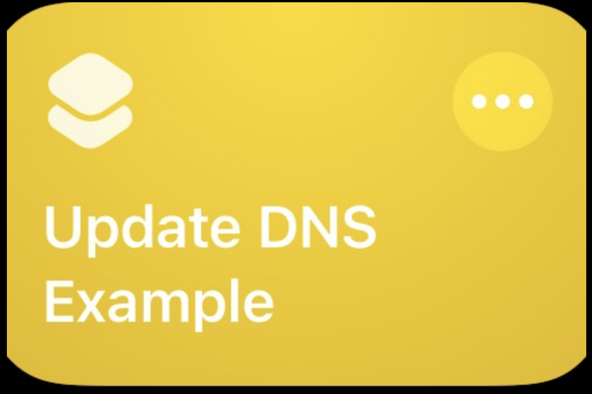
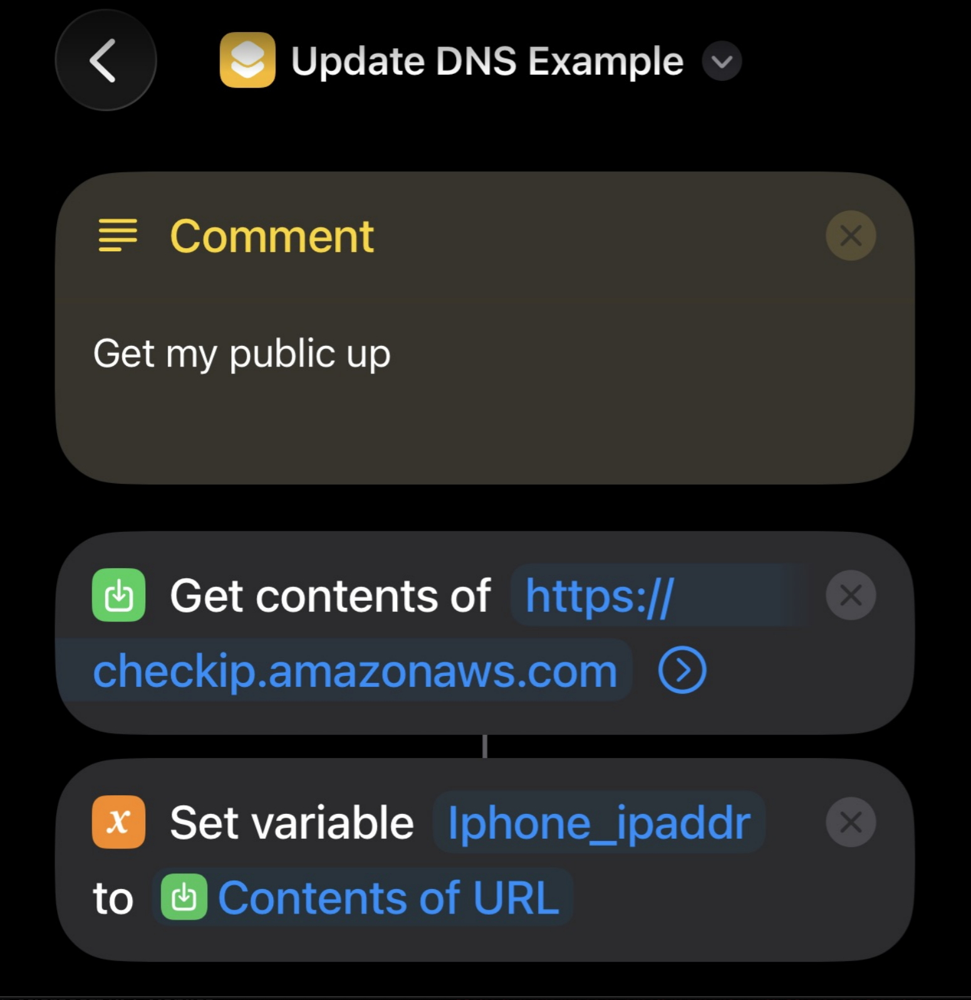
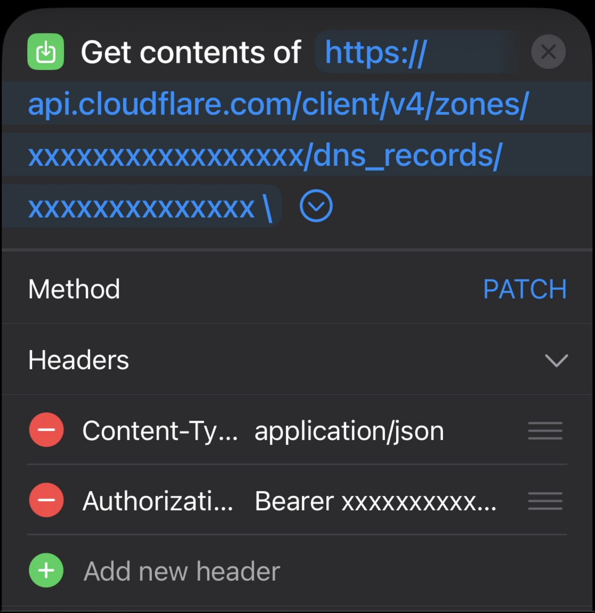
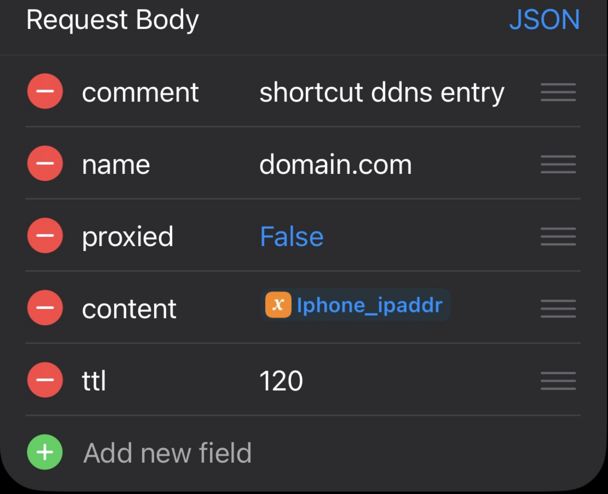

# Create IOS Shortcut to get your public ip address and set a cloudflare dns entry
I use this when traveling to:
    1:  connect to a public wifi network
    2.  run this shortcut to update a dns entry
    3.  my firewall uses dns entries for source based allowed policy

It doesn't really work for mobile networks generally because of carrier grade nat and frequent IP address changes.  

## Prerequisites:
- [Generate a CF API Auth Token](https://www.stephen-barron.com/cloudflare-token-generation/)
- 

## Step 1:
    Get Contents of https://checkip.amazonaws.com
        Method:  Get

## Step 2:  Set Variable
set Iphone_ipaddr to **Contents of URL**

## Step 3:  get contents of url
- get contents of https://api.cloudflare.com/client/v4/zones/<Cloudflare Zone ID>/dns_records/<DNS Record ID>\
  - method:  **PATCH**
  - Headers: 
    - content-Type:  **application/json**
    - Authorization:  **Bearer <token>**

        Request Body  **JSON**
            Comnent
            Name  **<dns record>**
            proxied **FALSE**
            content **Iphone_ipaddr**
            ttl **120**

